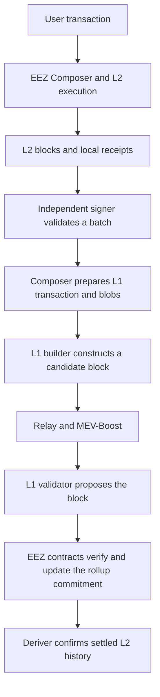

# Block production and settlement lifecycle

There are two connected lifecycles: **producing L2 blocks** and **settling those
blocks on L1**. An L2 transaction can execute and get a receipt before L1 has
accepted its result.

This guide explains the [local Hydration testnet](local-devnet.md), with L1 chain
ID **414141** and L2 chain ID **424242**. Its L2 block interval is **2 seconds**,
while L1 has **12-second slots**. Configuration and validation examples below
describe the local setup established on 2026-11-26; other networks may select
different timing and settlement policies.



## 1. Transactions enter EEZ

There are two main entry paths:

- **Ordinary L2 transactions** enter the L2 mempool: transfers, contract calls,
  counter increments, etc.
- **Cross-chain requests** enter Composer's dedicated fronts. Composer holds
  these requests until it can prepare their execution against the relevant L1
  context.

Composer coordinates transaction selection, execution, proving and settlement.
The EVM executes the transactions.

For Hydration, a Live block's prefix is ordered as:

```text
optional L1 history update → optional oracle update → optional keeper transaction → ordinary transactions
```

The configured roles and execution rules come from genesis. See the
[Hydration inventory](../hydration.md) for their activation and consensus rules.

## 2. The local sequencer produces L2 blocks

The sequencer follows the genesis-defined clock and builds blocks from local
state.

It executes transactions, calculates receipts and state roots, saves the blocks
and captures the execution witnesses needed for independent validation. A
witness contains the state information required to replay execution without
holding the complete chain database.

**Ordinary production continues when L1, the signer or settlement is unavailable**,
provided local execution and storage remain healthy. In that situation, the
locally produced chain can advance while its settled head stays behind.

L1 history updates are recorded explicitly in L2 transactions. When an eligible
update is unavailable, execution inherits the previously recorded origin.

The [recorded-history and offline-proving contract](../proposals/l1-origin-and-offline-proving.md)
defines this separation between the local clock and settlement work.

## 3. Composer decides when to prepare settlement

Six L2 positions fit into our 12-second grid. The final position is a **Sync
boundary**, where cross-chain effects can be incorporated and settlement can end.

Three labels describe block production:

| Label | Meaning |
| --- | --- |
| **Live** | A block produced at the ordinary clock cadence |
| **Future** | A block constructed ahead of its timestamp to leave time for validation and submission |
| **Sync** | The boundary block where the matching cross-chain effects can land |

A Sync boundary does **not** mean a transaction must be posted to L1 every
12 seconds. A boundary can remain an ordinary checkpoint without cross-chain
effects or an L1 post.

Our current policy prepares settlement when ordinary transactions or eligible
cross-chain work require it. Otherwise, it consolidates empty history after
**900 unsettled L2 blocks**, roughly 30 minutes. Preparation can begin after
position three, nominally six seconds into the interval.

The [settlement policy](../configurable-settlement-policy.md) owns the exact
triggers, timing, admission limits and retry rules.

## 4. The independent signer validates the proposed batch

Composer sends the proposed block window, execution witnesses, L1-header
evidence and settlement data to `eez-proof-signer`.

The signer independently checks execution, Hydration rules, block commitments,
data encoding and the proposed settlement effects. It recomputes what it is
being asked to authorize. It receives the evidence needed for validation rather
than querying L1 or L2 RPC itself.

Our current backend then produces an **ECDSA attestation**. Its security depends
on the authorized signer enforcing those checks. A ZisK backend would provide
execution-proof verification instead; that backend is still outside this local
deployment.

A signer response means the proposal passed validation. L1 inclusion and
finality happen later. The [signer specification](../../crates/eez-proof-signer/SPEC.md)
defines its checks and the guarantees an attestation establishes.

## 5. Composer submits the L1 bundle

Composer prepares an L1 settlement transaction carrying the attestation and
associated blobs. The blobs publish the data needed to reconstruct L2 history.

For live cross-chain execution, the proposal is bound to the intended L1 parent
and timestamp. This gives Composer a deadline: execution preparation, signing
and submission must finish while that target is usable.

Composer sends an ordered bundle to the **L1 builder**. This is separate from
the L2 payload-building machinery inside EEZ. Bundle acceptance is an
acknowledgement, not a guarantee of inclusion or settlement. A missed opportunity
retains work for reconciliation and retry under the settlement policy.

## 6. Builder, relay and validator produce the L1 block

The builder constructs a candidate L1 execution block containing the settlement
transaction and any associated transactions.

The relay handles the builder's bid and payload delivery. **MEV-Boost** connects
that relay path to the L1 proposer. The selected validator proposes the resulting
beacon block, and the other validators attest through L1's consensus protocol.

Redis and PostgreSQL support the relay's coordination and records. They do not
determine L2 execution validity. The [private L1 builder runbook](../../deploy/swarm/local/docs/PBS.md)
describes these services and their operational checks.

## 7. On-chain acceptance establishes settlement

When the settlement transaction executes, the EEZ contracts check the authorized
proof system, attestation, context and starting commitments. Accepted effects
advance the registered rollup commitment.

EEZ's deriver then observes canonical L1 execution and reconciles it with L2
history. Cross-chain requests remain owned until their actual consumption is
established; builder acknowledgement or a transaction receipt alone cannot
establish completion of every requested effect. Partial consumption is supported.

There are three distinct milestones:

| Milestone | What you have |
| --- | --- |
| **Locally executed** | An L2 block and receipt |
| **Settled / safe** | A matching commitment accepted on canonical L1 |
| **Finalized** | That settlement's L1 history has finalized |

Coming from Substrate, the Composer/sequencer is closest to the block-authoring
machinery. The independent signer checks proposed execution. Finality comes
from the settlement L1's consensus.

## Example: the local counter canary

The first local counter test followed this path:

```text
Counter executes in L2 block 550
    → signer validates the window through block 558
    → one-blob settlement transaction is included in L1 block 13022
    → independent RPC checks confirm the matching canonical L2 commitment
```

That check established canonical settlement of the counter increment. It did
not assert that the settlement block had already finalized. The
[local validation record](local-devnet.md#local-validation) distinguishes this
result from the remaining cross-chain, follower, recovery and ZisK qualification.
